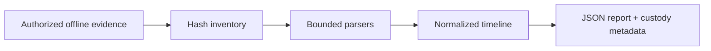

# Architecture and threat model

The CLI accepts only explicitly named evidence files. Each file is inventoried and hashed before and after parsing; changed evidence aborts the report. Parsers emit normalized events with UTC and original timestamps, evidence references, and SHA-256 of the original record. The report sorts events without modifying source order or files. Analyst and origin are explicit operator inputs. Hash-linked custody metadata records the analysis registration step, but cannot prove prior collection history.

Threats include malformed evidence, timestamp ambiguity, source mutation during analysis, command execution, and fabricated custody claims. Current controls are read-only parsing, size/record limits, explicit RFC 3164 year and timezone, raw-record hashes, before/after evidence hashes, and no command export. EVTX uses an optional parser and bounded XML records; this adapter remains unverified without the dependency and real authorized files. There is no server, database, or remote collection capability in this milestone.
